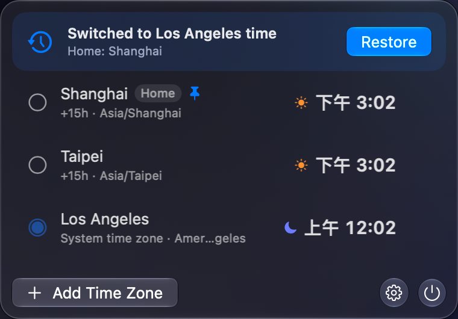

# Time Zone Switcher

[](https://github.com/daxiangme/time-zone-switcher/actions/workflows/ci.yml)
[](https://github.com/daxiangme/time-zone-switcher/releases/latest)
[](LICENSE)


[中文说明](README.zh-CN.md)

A macOS menu bar app for temporarily switching the system time zone and restoring it later.

Use it when you need to test calendar, schedule, subscription, localization, or region-sensitive behavior without permanently changing your normal system setup.

[Download the latest release](https://github.com/daxiangme/time-zone-switcher/releases/latest)

<p align="center">
  
</p>

<p align="center">
  
  
</p>

## Why It Exists

Developers, QA engineers, product builders, and support teams often need to answer questions like:

- Does this calendar event render correctly in Pacific Time?
- Does a scheduled workflow cross midnight in another region?
- Does a subscription, billing period, or date boundary behave correctly outside my local time zone?
- Can I reproduce a customer issue that only appears in another time zone?

Time Zone Switcher makes that workflow fast and reversible from the menu bar.

## Features

- Menu bar only: no Dock icon.
- Add several IANA time zones, such as `America/Los_Angeles` and `Asia/Shanghai`, and see each local time together.
- Set any saved time zone as the system time zone. The first switch remembers the original time zone until you restore it.
- Choose the menu bar clock: follow the system time zone, show only the icon, or pin one saved time zone.
- Choose a time format from presets, including time only, abbreviation and time, a Chinese date, an English date, or a custom pattern. Seconds are optional.
- Choose the interface language: follow the system, Simplified Chinese, or English. The language does not decide the clock pattern.
- Localized time zone display names with the IANA identifier kept visible.
- Native SwiftUI controls and macOS material styling.

## Privacy and Security

- No analytics.
- No network requests.
- No background polling jobs.
- Administrator permission is requested only when you change or restore the system time zone.
- The system command used is:

```bash
systemsetup -settimezone <IANA time zone identifier>
```

## Installation

Download the latest release archive, unzip it, and move `Time Zone Switcher.app` to `/Applications`.

This project currently publishes unsigned, non-notarized open-source builds. On first launch, macOS may block the app because it was downloaded from the internet. To open it:

1. Open **System Settings**.
2. Go to **Privacy & Security**.
3. Find the blocked app message and choose **Open Anyway**.

You can also Control-click the app and choose **Open**.

## Build From Source

Requirements:

- macOS 26+
- Xcode 26+
- Swift 6.3+

Build the app bundle:

```bash
Scripts/build_app.sh
```

Run it:

```bash
open "dist/Time Zone Switcher.app"
```

Create a release archive:

```bash
Scripts/package_release.sh
```

## Roadmap

- Favorite time zones.
- Keyboard shortcuts.
- Optional DMG packaging.
- Optional notarized builds.
- More localization.

## Contributing

Contributions are welcome. See [CONTRIBUTING.md](CONTRIBUTING.md).

## License

MIT
